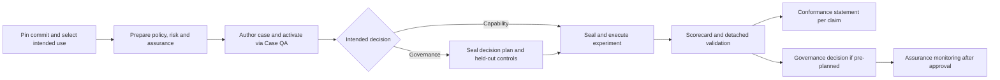

# Adoption Guide

- Status: unpublished 0.1.0 publication candidate
- Version: 0.1.0
- Purpose: an informative reading and dependency guide for a draft-conforming
  case, experiment, scorecard, and conformance statement. The linked primary
  contracts determine the requirements.

## Start here: the A1 path

If you have not yet made a claim under this standard, start at
[A1](conformance.md#baseline-a1). It needs two people, Git, and six schemas:

1. **Author cases** (`case-1`): task, repository commit, the four scope
   tests, deterministic checks, hard gates, and oracle isolation.
2. **Validate cases** (`case-qa-1`): a known-good result passes, a no-op and a
   plausible wrong result fail, stably; a second person confirms inferability
   and scope before any result exists.
3. **Seal the run** (`run-manifest-1`): arms including a no-action baseline
   and a non-agent control, trials per case, replacement policy, claims with
   decision rules, and `stat-defaults-v1`. Commit it before the first attempt.
4. **Run** (`attempt-ledger-1`): append every attempt, valid or not, to a
   hash-chained ledger in Git.
5. **Score** (`scorecard-1`): counts, outcomes, gate failures, per-case
   results, identification bounds, and intervals; gates, outcomes, claims, and
   verdict stay in separate fields.
6. **State conformance** (`conformance-statement-1`): one result per A1
   requirement, reviewed by the second person.

The [worked example](../examples/core/README.md) shows every step with numbers.
Everything below describes A2 and A3, which keep the same artifacts and add
attachments and stronger forms.

## A2 and A3

A2 and A3 use the same six artifacts as A1. They add attachments and stronger
forms; nothing from the A1 path is replaced. Use the
[requirement registry](requirements.md) to find each rule's authoritative
location. Measurement and governance share a preparation path; governance
planning branches **before** the run it will judge:



A conformance statement makes one claim, `experiment` or `decision`, and
covers every requirement registered for that claim at the declared assurance
level. A deviation records the unsupported rule and affected claim
restrictions; it does not permit omitting a required result row
([Conformance](conformance.md)).

## Local development

The repository contains contracts only: prose, JSON Schemas, profiles, and
[examples](../examples/). One lightweight check validates them:

```bash
npm ci
npm test   # schemas compile, examples match expectations, bundled contracts and links resolve
```

The check is not a conformance validator. Semantic validation — digest
reproduction, outcome replay, ledger continuity, independence — belongs to an
implementation of this standard. If you change a schema, update its valid
example and any affected invalid example in the same pull request.

## A2 and A3 attachments and stronger forms

### Pin the draft

The standard is an unpublished `0.1.0` candidate. Record the exact commit and
the version `0.1.0`; after publication you must additionally pin the protected
annotated tag `v0.1.0`. Every artifact you produce later references these pins.
Saying “based on” the standard is not a conformance claim.

### A2: add to each A1 artifact

- **Policy and risk.** Select the intended decision class and risk/assurance
  path under [ASSURE-001 and RISK-001](standard.md#assurance-levels). Prepare an
  authenticated adopter-owned operational policy
  ([`operational-governance-policy.schema.json`](../schemas/operational-governance-policy.schema.json));
  the bundled [Governance Policy](governance-policy.md) and
  [Escalation and Stop Matrix](governance-policy.md#escalation-and-stop-matrix)
  leave adopter thresholds, owners, and SLAs unset, and an unset required value
  blocks the affected path. Record the risk assessment
  ([`risk-assessment.schema.json`](../schemas/risk-assessment.schema.json)).
- **Case** ([`case.schema.json`](../schemas/case.schema.json)): fill the
  optional properties — `workspaceManifest`, `evaluationProfile`,
  `outcomeProfile`, `lifecycle`, `contamination`, `leakageControls`,
  `decisionSurfaces`, `exposureBudget`, `interactionProtocol`. The bundled
  executable profile is `repo-change-v1`; it demonstrates interoperability
  mechanics, not empirical validity.
- **Case QA** ([`case-qa.schema.json`](../schemas/case-qa.schema.json)): record
  stages 3–8 of the [Case QA Playbook](case-qa-playbook.md) in `stages`, with
  `defects`, `graderValidation`, and `decisionSurfaceValidation`. Stage 7 may be
  `not_applicable` only with a rationale, and that gap restricts dependent
  claims.
- **Run manifest** ([`run-manifest.schema.json`](../schemas/run-manifest.schema.json)):
  attach `evaluationProfile`, `validityArgument` (with its baseline inventory),
  `riskAssessment`, `policy`, and `heldOut` (budget and ledger); add
  `comparativeDesign` for several arms and `decisionPlan` for governance use.
  Seal all of it before the first trial. A diagnostic or development run cannot
  acquire a missing decision plan or held-out controls retroactively.
- **Scorecard and statement:** the scorecard may carry `governanceStatuses`,
  `validity`, and `telemetry`; the conformance statement
  ([`conformance-statement.schema.json`](../schemas/conformance-statement.schema.json))
  **MUST** add a `validationEnvelope`, a separate `validation-envelope-1`
  produced by an independent validator whose subject digest equals the statement
  digest. A statement without a passing envelope is an unauthenticated
  assertion, not conformance. The
  [Integrity and Semantic Validation Contract](evidence-and-validation-contract.md#integrity-and-semantic-validation-contract)
  recomputes hashes, formulas, ledger continuity, verdict implications, and
  outcome replay for claim-bearing cells.

### A3: add to A2

An evaluation threat model (`threatModel`), a separate security approval
(`securityApproval`), a post-decision assurance plan (`assurancePlan`), and
adversarial positive controls.

## Governance path (decisions)

These steps consume the validated evidence from the pre-planned governance run.

### Make a governance decision

Decisions use [`schemas/governance-decision.schema.json`](../schemas/governance-decision.schema.json)
and the [decision-record template](../templates/governance-decision-record.md).
An approval additionally binds a post-decision assurance plan. Resolutions,
waivers, renewals, and rollbacks are appended to the adopter's
version-controlled governance record; the scorecard itself is immutable.

### Monitor via assurance observations

Every expected monitoring window is recorded as an observation in the
governance record. Missing, late, or unauthenticated evidence triggers
`assuranceEvidenceMissing` and suspends the affected approval. Version 0.1.0
publishes no schema for these records.

## Frequently used rules

- **Pre-registration (I3).** Everything that decides a verdict - case set,
  thresholds, gates, claims and statistics, success definition - is sealed before
  the run and cannot be changed after results are observed.
- **Non-compensation (I1).** An acceptance, security, or policy violation
  cannot be offset by quality, cost, or composite scores.
- **Fail closed (I10).** An indeterminate gate or blocker is not a silent pass.
- **Evidence bounds claims (I6).** Positive, comparative, and governance claims
  are limited to the pre-declared target population, strata, and the statistics
  sealed in the run manifest; `insufficient_evidence` is a verdict, not a failure.
- **Evidence fits the construct (I9).** Correctness and quality must use the
  strongest evidence that directly measures the declared construct;
  deterministic verification is required when the outcome is objectively
  executable or mechanically inspectable, and model-based grading cannot be the
  sole evidence for a hard safety gate or deterministic fact.

## What the standard deliberately does not do

This repository provides no evaluation runner, grader, benchmark cases,
certification, or leaderboard. If you need those, this standard is the contract
your implementation should satisfy, not the implementation itself.
