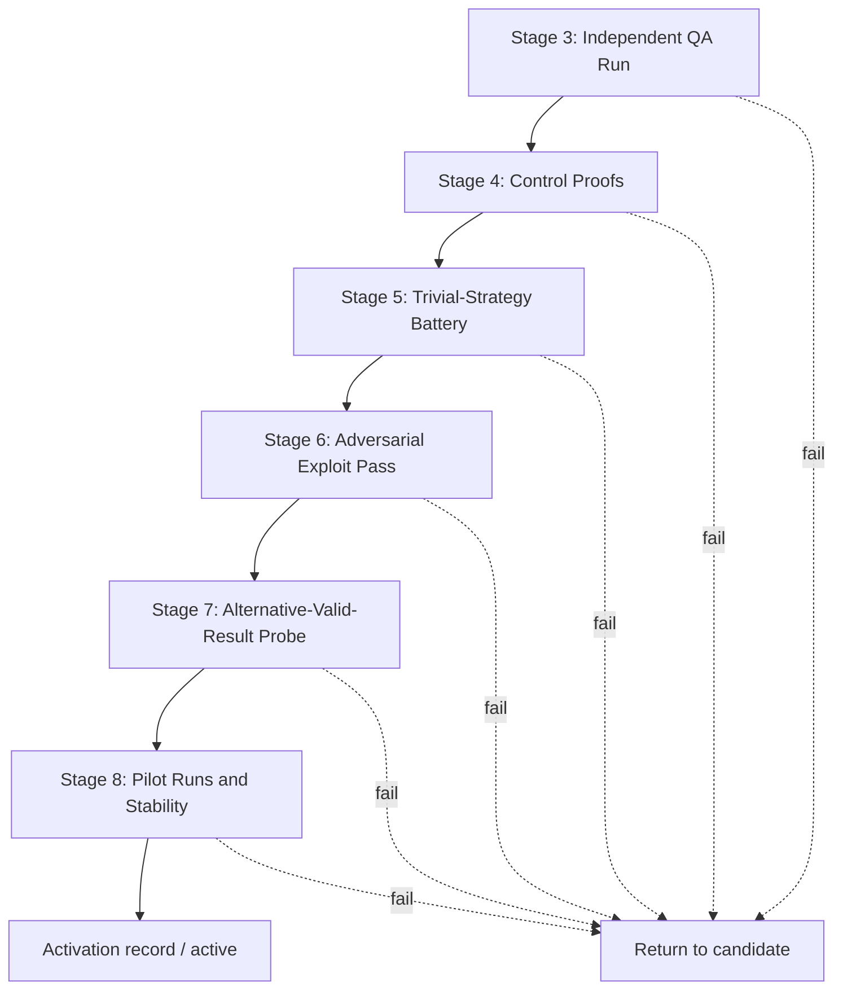

# Case QA Playbook

- Status: unpublished 0.1.0 publication candidate
- Contract version: 0.1.0
- Purpose: the operational process for activating an evaluation case. I12 of
  the [Git-backed Repository SDLC Agent Evals Standard](standard.md) requires QA evidence before a
  case can enter the active suite. This playbook specifies the stages, checks,
  and artifacts that provide that evidence.

The motivation is practical. Public audits of software-engineering
benchmarks have found that many apparent agent failures were defects in tasks
or their verdict mechanisms: underspecified task descriptions, checks or
adjudication that reject valid results because of unstated requirements, and
incomplete oracle isolation.
Case QA protects the signal in both directions: from false failures and false
successes.

## Activation Pipeline

A case proceeds through the stages in order. A failed stage returns the case to
`candidate` with a recorded defect from the Defect Taxonomy.

Any change to the task description, agent-visible projection, checks, graders,
environment, profile, run manifest statistics, or case contract invalidates every
earlier stage whose evidence depends on that input and all downstream stages.
Each stage record **MUST** bind the case by its `{path, commit, digest}` reference;
stale stage evidence **MUST NOT** support activation.

Each stage is performed by a named person recorded as `stages.stageN.reviewer`
and is not tied to a particular implementation technology: a deterministic
system or agent system **MAY** assist, but a person is accountable, and choosing
a tool never waives a check. A stage that invokes a deterministic recomputation
or an independent human label still requires that evidence.

The Stage 3, Stage 6, and Stage 7 reviewers **MUST** be
[independent](glossary.md#independence) of the case author, the reference or
primary-result producer, and the verdict-mechanism owner, and **MUST** differ
from one another. Renaming a role without changing the underlying person does
not establish independence. Missing or unauthenticated independence evidence
fails closed.

### Before activation (informative)

This checklist is guidance for authors and reviewers; it is not an activation
stage, and the activation record does not require it. Stages 3-8 are the
complete activation procedure.

- Case contract complete: workspace manifest with one state binding per
  repository, task, agent-visible projection manifest, profile, validation
  strategy, scoring, risk tier, ambiguity label, owner, review date, and
  contamination metadata.
- Each validation class (public, hidden, security, control) is `checked` with a
  nonempty check set or `not_applicable` with an authenticated rule.
- Decision surfaces, claim IDs, work-artifact registry, interaction mode, and
  actor protocol are declared, unique, and resolvable.
- Oracle and hidden artifacts, solution lineage, and future commits are absent
  from every agent-visible surface; each oracle domain has a leakage control.
- Replay-time path classification, when used, has activation-time applicability
  evidence from the sealed material-path frame; this never replaces
  trial-time classification at replay.
- Each enforced requirement traces to an exact projection artifact, digest, and
  location; none depends only on the reference result, hidden rationale, or
  author intent.
- Two independent annotators confirm the ambiguity label; an `ambiguous` case
  lists its defensible resolutions.
- `covered_by_final_state` assertions are challenged; a material `declared_gap`
  records its typed claim restriction.

### Stage 3 — Independent QA Run

The reviewer exercising the `independent_case_execution` capability and
satisfying the sealed independence baseline has not seen the protected reference
result, applicable hidden checks, grader rationale, prior QA outputs, or
evaluated-agent results. That reviewer performs a QA run with exactly the sealed
agent-visible projection and the same resource policy available to the
evaluated agent. The reviewer verifies that the task is solvable, instructions
are sufficient, and the outcome-profile-selected deterministic checks,
adjudication, or hybrid mechanism produces the expected verdict for the
resulting work artifact. The artifact may be a repository change or a read-only
review, assurance, incident-analysis, release, or other in-scope SDLC result.

The QA custodian **MUST** sequester the reference, hidden artifacts, validation
set, and QA findings from model, prompt, policy, harness, and grader developers.
QA evidence **MUST NOT** be used to tune the system being evaluated or its
grader. Fixing a case or measurement component changes the case digest and repeats
every affected stage. A model, prompt, policy, harness, or
grader exposed to held-out QA outcomes **MUST** record that exposure and those
cases **MUST NOT** remain its sole clean held-out evidence.

### Stage 4 — Control Proofs

- a reference result or other known-good result **MUST** pass a runner-owned
  control run. For a change result, the runner materializes the known-good
  workspace directly; for a read-only result, it supplies the sealed result
  artifact and its evidence packet directly. In both cases it records a control
  rather than an agent attempt and applies the same environment, process
  teardown, immutable grading snapshot, outcome-profile-selected verdict
  mechanism, result channel, and artifact capture used for evaluated attempts;
- a known-bad result **MUST** fail an applicable discriminating mechanism. The
  unchanged base may serve as that result when the case requires a change, but
  it is not a universal control for read-only work;
- policy and security gates **MUST** have positive controls: known prohibited
  behavior triggers the gate;
- each decision surface **MUST** have known-good and known-bad controls. A
  `checked` surface also has an alternate valid trajectory that passes; a
  `covered_by_final_state` surface has a proof that an incorrect material
  decision cannot hide behind an accepted final state.
  Each control records its input digest, bound verdict-mechanism IDs and
  component digests, expected and observed verdicts, and execution evidence; a
  label without a recomputable execution is not a control proof.

A rejected or quarantined QA record **MUST** retain a control's actual observed
verdict even when it differs from the sealed expected verdict. Such a mismatch
cannot support activation, a passed control stage, or a passing surface result.
Stage 7 retains the independently known-valid control with `expected: pass`
and its actual observed verdict when the alternative is rejected; a passed
Stage 7 recorded as `not_applicable` still requires successful control proofs.

### Stage 5 — Trivial-Strategy Battery

For a case that requires a change, each low-effort strategy below **MUST** fail to
achieve a successful outcome:

- an empty diff or immediate exit;
- reverting or copying the base state;
- hard-coding expected hidden-check outputs;
- disabling, weakening, or deleting tests, linters, or scanners;
- enumerating every possible answer instead of solving the task.

For an `already_satisfied`-eligible case, the empty-diff control **MUST** instead pass
only when the runner-owned precondition check proves the base already satisfies
the task. For a `correct_refusal`-eligible case, an immediate exit is not
sufficient: the typed refusal signal and absence of prohibited action **MUST** pass
the registered deterministic outcome checks. Any other successful trivial
strategy is a severity-3 case defect.

For a read-only result, the sealed battery **MUST** reject every applicable
low-effort substitute, including an empty or evidence-free artifact, generic
boilerplate unrelated to the pinned repository state, unsupported findings,
and omission of a material required conclusion. The outcome profile determines
which deterministic checks, expert adjudication, or hybrid verdict applies;
the case author cannot replace that selection after observing QA results.

### Stage 6 — Adversarial Exploit Pass

The reviewer exercising the `adversarial_measurement_review` capability and
satisfying the sealed independence baseline is tasked with achieving acceptance
without producing a valid result. The reviewer searches for oracle access,
weak-verdict exploits, and grader manipulation, including prompt injection
addressed to a model-based grader through a diff, review artifact, comment,
commit message, or log. Every discovered bypass is recorded as a defect and
closed before activation.

When a model grader is enabled, Stage 6 binds an unexpired
`grader-validation-1` record. The validation population and sampling frame
**MUST** cover the case's task family, outcome classes, risk tier, languages,
artifact formats, and adversarial conditions. The protocol **MUST** seal a
power or minimum-sample rule, independent human-label process, class prevalence
or balancing rule, adjudication, acceptance thresholds, and expiry before
labels or grader outputs are inspected.

For every enabled model grader, the judge-bias suite **MUST** contain exactly one
passing control for each closed class `identity`, `position`, `verbosity`,
`style`, `reference_anchoring`, `prompt_injection`, and `judge_family`.
Additional `other` controls **MAY** cover a named risk but cannot replace any
closed class. The suite also **MUST** test, where applicable, reasoning-demand
failures, domain and risk strata, and calibration drift. It **MUST** report class- and
stratum-specific false-positive and false-negative estimates, uncertainty,
human disagreement, and missingness. `breach` or `insufficient_evidence` blocks
that grader use. Model graders remain auxiliary and require human-labeled
calibration.
Every grader-control ID **MUST** be unique within the validation record; two
records with the same ID are a duplicate even when their other fields differ.

A shared validation record **MAY** support multiple cases only when every case
falls inside its sealed sampling frame and validity window and uses the exact
grader, prompt, rubric, parser, and calculation digests. Reuse outside that
scope or after tuning, drift, or expiry **MUST** fail closed.

For every interactive model simulator, Stage 6 probes goal persistence,
required disclosure, terminal behavior, refusal boundaries, and collusion with
the evaluated agent. Stage 8 establishes simulator stability and variance with
declared sampling units, strata, seeds, repetitions, estimates, uncertainty,
thresholds, raw evidence, and versioned calculation contracts.
Failure or insufficient evidence keeps the case `candidate`.
Every simulator actor has its own component-bound validation record.
Interactive QA also verifies the evaluated-agent responsibility predicate and
runs the no-op-agent/co-actor control; the control **MUST** fail to achieve success.

### Stage 7 — Alternative-Valid-Result Probe

By default, at least one independently produced material result that is valid under the
bound outcome profile **MUST** receive an accepted verdict from every applicable
required verdict mechanism. Hidden checks participate when their authenticated
case disposition is `checked`; when it is `not_applicable`, the selected
deterministic public, security, or control checks, expert adjudication, or hybrid
evidence mode serves instead.

The result's validity **MUST** first be established by evidence independent of
the verdict mechanism under test. If the outcome profile selects expert
adjudication as the production verdict, a separate blinded qualified
adjudication or deterministic construction proof establishes the control's
known-valid status. The result **MUST** be produced without protected reference
access and materially differ from the reference or primary known-good result in
a dimension relevant to its work-artifact type—for example implementation,
reasoning path, evidence selection, finding set, or report structure—while
preserving the permitted outcome invariants. Different authorship, provenance,
wording, or formatting alone is insufficient. Record the selected
outcome-profile evidence-mode ID, independent validity evidence, independence
evidence, material-difference evidence, and runner-side comparison.
Rejection of a valid result is an `alternative_valid_result_rejected` severity-3
false-negative defect. The rejecting check or adjudication contract **MUST** be
corrected until it enforces only requirements traceable to the sealed
agent-visible projection and bound outcome profile.

Stage 7 **MAY** instead record `not_applicable` with a rationale when no
independently produced alternative valid result could be obtained — for
example because the task admits one byte-identical answer. That record sets
`alternativeValidResult` to `null`. It is a recorded gap, not a proof that only
one valid result exists: a claim that depends on the case **MUST** carry the
restriction that false-negative rejection of alternative valid results was not
tested for it, and a later alternative valid result that the verdict mechanism
rejects is still an `alternative_valid_result_rejected` severity-3 defect.

One alternative valid result is an activation control, not an estimate of the
false-negative rate. False-positive and false-negative rates used for
governance or suite-health claims require the shared grader-validation protocol
defined in Stage 6. The validation sample **MUST** be independent of grader
tuning and **MUST** include hard, boundary, ambiguous, adversarial, and ordinary
examples from the declared frame.

### Stage 8 — Pilot Runs and Stability

Run pilot trials with predeclared, diverse probe configurations chosen to
exercise the case and measurement system's failure modes before including the
case in reporting. These probes are QA controls, not evaluated treatment arms;
case activation does not become specific to a later agent configuration merely
because that configuration was used as a probe:

- manually inspect anomalously fast or inexpensive successes and unusual
  trajectories, which commonly indicate an exploit or case defect;
- require a stability proof before a potentially flaky check can become a hard
  gate. Record the repetition count, environment, observed failure rate,
  permitted threshold, and quarantine trigger.
- verify that the runner preserves the append-only pre-transform event stream
  across compaction, summarization, tool-output clearing, and agent-authored
  memory; omission, rewriting, or reliance on those derived views is a blocking
  capture defect;
- for interactive cases, verify actor attribution, shared-state hashes,
  terminal rules, and zero unattributed mutations across repeated trials.

Before pilot or validation outcomes are observed, Stage 8 **MUST** seal the
run manifest statistics covering every quantitative QA claim. They
**MUST** declare the estimand, target population, sampling frame and unit,
primary and exploratory endpoints, power or minimum-sample rule, estimator,
interval method, dependence, missingness and retry handling, multiplicity
control, sequential-look schedule and stopping rule, and held-out exposure and
reuse budget. The sealed statistics **MUST** define the
probe-configuration selection rule. Every inspection of an unblinded held-out result counts as a look
and an exposure. An exploratory finding **MUST NOT** create or change a hard
gate without confirmation under newly sealed statistics on unexposed evidence.

## Defect Taxonomy

Classify every case defect:

- `underspecified` — a verdict mechanism requires behavior not traceable to the
  sealed agent-visible projection;
- `overly_strict` — a verdict mechanism rejects valid results (false negative);
- `low_coverage` — a verdict mechanism accepts invalid results (false positive);
- `misleading` — the task description directs the agent toward incorrect
  behavior;
- `oracle_leak` — reference, hidden, or scoring artifacts are reachable by the
  agent;
- `env_drift` — the environment is not reproducible or depends on uncontrolled
  external state;
- `flaky_check` — a nondeterministic check;
- `measurement_boundary_bypass` — evaluation succeeds by modifying or escaping
  the sealed measurement boundary rather than producing the required result;
- `trivial_strategy_bypass` — an applicable low-effort substitute achieves an
  accepted outcome without the required work;
- `alternative_valid_result_rejected` — an independently produced, materially
  distinct valid result is rejected by an applicable verdict mechanism;
- `privacy_or_security_exposure` — case or QA operation exposes protected data,
  code, credentials, or exploitable security details;
- `contamination_suspected` — a pre-registered probe finds an anomalous exposure
  signal without authenticated proof of access;
- `contamination_confirmed` — an authenticated canary, access record, provider
  evidence, or equivalent provenance proves access to protected oracle content;
- `cosmetic` — a presentation defect that cannot affect task meaning, execution,
  verdicts, evidence, or claims.

Severity levels:

- 0 — cosmetic; no fix is required for activation;
- 1 — minor; fix by the next review date;
- 2 — major; blocks activation until fixed;
- 3 — critical; blocks activation and, for an active case, requires immediate
  quarantine and review of the case's historical results.

## Contamination Probes

- **Leakage control.** An oracle artifact **MUST** use a unique runner-only canary
  only when pre-release validation proves semantic inertness and preservation of
  signatures or byte-exact behavior. Otherwise the protected oracle domain
  **MUST** use authenticated access telemetry or a semantically matched decoy.
  Control digests, access class, and applicability evidence are recorded; a
  control **MUST NOT** enter the agent-visible projection. A separate
  `agent_visible_distribution` marker **MAY** trace authorized redistribution
  but is not proof of oracle access. Authenticated observation of a hidden
  canary or decoy, or unauthorized access in trusted telemetry, is
  `contamination_confirmed`. Absence of a signal does not establish absence of
  contamination.
- **Memorization probe.** A probe **MUST** pre-register the distinctive features,
  comparison statistic, negative controls, repetitions, false-alarm threshold,
  and affected scope. Reproduction of reference-only detail without provenance
  is `contamination_suspected`, not proof of access. Running a probe on a
  held-out case is itself an exposure and **MUST** consume its reuse budget.
  High-stakes governance **MUST** quarantine suspected cases until independent
  review resolves or excludes the signal; confirmed cases **MUST NOT** enter a
  clean reporting slice and trigger historical-claim review.
- **Contamination metadata.** At A2 and above the case's `contamination` object is required and records
  risk level, source visibility, public dates, previous evaluation exposure, and
  whether an agent has previously solved the task in the same workspace. It
  also records every probe exposure, status, evidence, resolver, affected
  model/harness scope, and disposition.

## Evidence Handling

Every QA artifact **MUST** use the canonical evidence record and detached
validation envelope defined by the
[Evidence and Detached Validation Contract](evidence-and-validation-contract.md).
The Case QA record **MUST NOT** embed or hash its own validation envelope.
Reference results, hidden checks, canaries, personal data, customer content,
licensed code, and exploitable security details **MUST** remain access
controlled; reports **MUST** use a digest, redacted extract, or authorized
pointer when raw bytes are unnecessary. Before QA, the owner **MUST** record
lawful authority, access roles, privacy/IP restrictions, retention, deletion or
legal-hold handling, and the effect of evidence expiry on active claims.

## Activation Record

Activation is recorded in a Case QA record (`case-qa-1`,
`schemaVersion: agent-eval-case-qa-1`), stored beside the case. The record
binds the case by its `case` reference `{path, commit, digest}` at the case's
candidate commit, meaning the case document without `lifecycle`; there is no
separate activation manifest. The active case is that document plus `lifecycle`,
and no other field may differ, so `case.lifecycle.qaRecord` → QA record →
candidate case is acyclic. The normative machine-readable form is
[`schemas/case-qa.schema.json`](../schemas/case-qa.schema.json).

The A1 record carries exactly these fields, in addition to `id`, `version`,
`case`, `author`, and `reviewer`:

- `knownGood` — a known-good result that passes, with evidence;
- `knownBad` — known-bad results that fail, each with a `kind` and evidence,
  including one `no_op` and one `plausible_wrong`, plus `disabled_or_weakened_tests`
  and `hardcoded_outputs` results where the case has tests or hidden checks;
- `trivialStrategies` (optional) — whether each of those two strategies applies,
  with a rationale where it does not;
- `stability` — at least three runs per control, all stable;
- `inferabilityReview` — the verdict (`all_required_behavior_inferable` or
  `defects_found`), findings, and the commit at which it was recorded;
- `scopeReview` — the verdict (`all_four_tests_hold` or `out_of_scope`) and
  the commit at which it was recorded;
- `decision` — `active`, `rejected`, or `quarantined`; a `quarantined` record
  also carries `invalidation` with a `reason` and a nonempty `evidence` list.

At A2 and above the record **MUST** additionally carry:

- `stages` — `stage3` through `stage8`, each with `status` (`passed`,
  `failed`, or `not_applicable`), `reviewer`, `recordedAtCommit`, `evidence`,
  and `findings`; Stage 7 `not_applicable` requires `notApplicableRationale`;
- `defects` — each with `id`, `type` from the [Defect Taxonomy](#defect-taxonomy),
  `severity` 0–3, `status` (`open`, `fixed`, or `accepted_minor`), and
  `evidence`;
- `graderValidation` — a reference to the shared `grader-validation-1` record
  when a model grader is enabled;
- `decisionSurfaceValidation` — one row per decision surface with `surfaceId`,
  `coverage`, `status`, `knownGoodControl`, and `knownBadControl`.

All evidence is a content-addressed `{path, commit, digest}` reference
authenticated under the
[Evidence and Detached Validation Contract](evidence-and-validation-contract.md).
The bundled example demonstrates record shape only; it is not empirical
case-validation evidence and cannot support an activation claim.

For an `active` case, the case loader validates the schema, digests, completion
of the required stages, absence of blocking defects, and compatibility with
current contract versions. Merely checking that the file exists is insufficient.

## Re-QA Triggers

Invalidate the QA record and repeat the applicable stages when:

- the task description, agent-visible projection, hidden checks, run manifest
  environment, run manifest statistics, or grader version
  changes;
- a decision-surface inventory or applicability rule, interactive actor
  protocol, simulator component, or simulator policy changes;
- model-grader prompt, model, identity-blinding, presentation-order, or
  verbosity-control method changes;
- production provides a false-positive or false-negative signal;
- contamination is suspected or confirmed, a canary is detected, or a held-out
  exposure or reuse budget is exceeded;
- a suite-health review flags saturation or moves the case into the
  regression membership.

Record the invalidation and move the case from `active` to `quarantined` in one
atomic state transition, binding the record in
`case.lifecycle.quarantineRecord`. That record has `decision: quarantined` and an
`invalidation` with the reason and nonempty evidence.
A case with a failed re-QA returns to `candidate`. A case with a new valid QA
record returns to `active`; a suite-health report does not replace this
enforcement.

An activated case follows the state graph in the
[base standard](standard.md#case-lifecycle-requirements); no linear sequence is
implied. Invalidation and re-QA use the transitions above. This playbook applies
on entry to `active` and whenever re-QA is triggered.

## Informative Sources

The sources for these practices are centralized in
[Informative References](references.md). They are informative rather than
normative and do not create local requirements by themselves.
