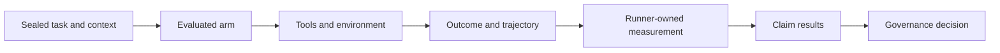
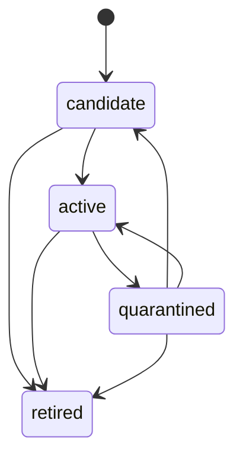

# Git-backed Repository SDLC Agent Evals Standard

- Status: unpublished 0.1.0 publication candidate
- Version: 0.1.0
- Purpose: implementation-independent requirements for evaluating agents that
  work with Git-backed code repositories across the software-development
  lifecycle (SDLC).

This standard specifies trustworthy evaluation evidence, not a runner, vendor
ranking, benchmark, or universal release threshold. Stable requirement IDs and
their evidence traceability are defined in the
[Requirements Registry](requirements.md). Terms are defined in the
[Glossary](glossary.md), concrete scorecard semantics in the
[Scorecard Contract](scorecard-contract.md), and adherence rules in
[Conformance](conformance.md).

Reading map (informative):

| Question | Start here |
| --- | --- |
| Does this evaluation fit the standard? | [Applicability](#applicability-boundary-and-profiles), [capabilities](#sdlc-capability-taxonomy), and [validity](#intended-use-and-validity-argument) |
| What applies across all evaluations? | [Invariants](#invariants), [assurance](#assurance-levels), and [risk](#risk-model) |
| How do I implement evidence digests? | [Integrity algorithms](evidence-and-validation-contract.md#integrity-and-semantic-validation-contract) |
| How do I prepare and maintain cases? | [Case lifecycle](#case-lifecycle-requirements) and [Case QA](case-qa-playbook.md) |
| How do I run, score, and interpret an experiment? | [Execution](#execution-requirements), [judgment](#judgment-requirements), and [statistics](#statistics-and-missingness) |
| How do I approve and monitor use? | [Governance](#governance-decisions-and-post-decision-assurance) and [suite health](#suite-health) |

## System Under Evaluation

`SCOPE-001` — An evaluation **MUST** identify the complete system under
evaluation, including every model, prompt, policy, harness, tool, permission,
budget, retrieval source, memory mechanism, approval path, environment,
external service, and stopping rule that can affect behavior. A model name alone
is not a system identity.

The measurement boundary is separate from the evaluated system:

An evaluation answers five distinct questions:

1. What construct and target population does the experiment represent?
2. What outcome did each arm produce, and what evidence supports that outcome?
3. Which consequential decisions and trajectories produced it?
4. Which safety, permission, policy, or measurement boundary was crossed?
5. What uncertainty, missingness, cost, review burden, and coverage limit
   qualifies each claim?

## Applicability Boundary and Profiles

`SCOPE-003` — This standard applies only when the evaluated work is grounded in
a sealed Git code-repository snapshot or repository-bound fixture. A case is
materially repository-grounded only when all four tests pass:

1. repository state is a necessary input rather than ceremonial context;
2. every material claim-bearing outcome has at least one acceptance invariant
   that traces to identified repository state, artifact, history, policy, or
   interface;
3. the result changes, verifies, or justifies a repository-governed artifact or
   SDLC decision; and
4. removing repository state would materially change the task, valid result,
   evidence, or verdict.

For this requirement, a sealed repository snapshot is an immutable,
content-addressed workspace manifest identifying every repository root, its
selected Git repository-state mode and base object, and every repository-
governed non-code input needed by the case. It may bind one repository or a
coordinated multi-repository workspace. An artifact's storage location inside
or outside a repository neither establishes nor defeats scope; the four tests
above do.

Version 0.1.0 defines executable repository-state semantics for Git repositories
only. A non-Git VCS evaluation is outside executable conformance until a
versioned repository-state contract supplies equivalent immutable state
identity, visible-history closure, oracle-isolation evidence, semantic
verification, and positive and negative examples. A format label or
content digest alone is insufficient. Adding such a contract would extend the
repository-state layer, not the standard's agent-domain scope.

### Git Repository-State Boundary Contract (`SCOPE-003`)

`workspace-manifest-1` is the primary executable repository-state identity.
Each repository entry **MUST** select exactly one closed mode:

- `tree_snapshot` — `baseTree` identifies the selected root tree. The object
  graph contains exactly that tree's recursive tree/blob closure, exposes no
  refs, and contains no commit objects.
- `bounded_ancestry` — `baseRevision` identifies a commit exposed through
  exactly one sealed local branch ref. `maxParentDepth` counts parent edges from
  that commit. The graph contains every commit whose minimum parent-edge
  distance is at most that limit and the complete recursive tree/blob closure
  of each such commit. `boundaryParentObjectIds` is the exact sorted set of
  parent IDs referenced beyond the limit and not otherwise included; omission
  before the boundary or embedding an object beyond it is invalid. The set
  **MUST** be empty when no included boundary commit names a parent beyond the
  limit, including a bounded projection whose selected base is a root commit.
- `full_ancestry` — `baseRevision` identifies a commit exposed through exactly
  one sealed local branch ref. The graph contains every reachable parent commit
  and the complete recursive tree/blob closure of every reachable commit. No
  shallow boundary is permitted.

For every mode, the verifier **MUST** recompute each Git object ID from the
declared object format and raw uncompressed object content, recompute the graph,
tree, and workspace digests using the invoked
[Git workspace digest projections](evidence-and-validation-contract.md#git-workspace-digest-projections),
and require exact object closure: missing,
unreachable, future, duplicate, or wrong-type objects are invalid. `files[]`
**MUST** equal the flattened non-directory, non-gitlink entries of the selected
base tree byte-for-byte, including Git mode. The only refs permitted are the
single declared base branch ref in commit-based modes; `tree_snapshot` permits
none.

Version 0.1.0 represents a Git path only when every raw tree-entry name is
well-formed UTF-8. Decoding and re-encoding each manifest path component
**MUST** reproduce those bytes exactly; implementations **MUST NOT** normalize
Unicode. A component **MUST** be nonempty, **MUST NOT** be `.` or `..`, and
**MUST NOT** contain `/`, `\`, or NUL. Flattened file, gitlink, and non-root
workspace repository paths **MUST** be relative slash-separated paths with no
empty component, leading slash, or drive-absolute prefix. `repository.path`
**MAY** be `.` only for a repository at the workspace root. Subject to those
exclusions, spaces and all other Unicode scalar values with a well-formed UTF-8
representation are permitted.
`files[]` and `gitlinks[]` **MUST** be strictly ordered by unsigned
lexicographic comparison of their complete UTF-8 path bytes. A repository with
a non-UTF-8 tree-entry name is outside the executable path contract in 0.1.0;
it **MUST NOT** be silently decoded with replacement characters.

This UTF-8 boundary applies only to Git path identity. Commit objects remain
raw byte strings for hashing and closure. Their structural `tree` and `parent`
headers **MUST** contain the required ASCII names and hexadecimal object IDs,
but other header values and commit-message bytes **MUST NOT** be rejected merely
because they are not UTF-8.

A base-tree entry with Git mode `160000` **MUST** have exactly one matching
`gitlinks[]` record. That record **MUST** name a separate repository entry whose
workspace-relative path equals the containing repository path joined with the
gitlink path (`gitlink.path` alone when `repository.path` is `.`), whose commit-based
`baseRevision` equals the gitlink target and whose Git object format equals the
containing repository's format. The gitlink target is not embedded in the
containing repository's object graph. A missing, ambiguous, tree-only, format-
or revision-mismatched linked repository is invalid.

Version 0.1.0 does not define Git LFS object transport, authorization, or
materialization. A reachable blob recognized as a Git LFS pointer therefore
makes the workspace manifest invalid; `.gitattributes` without a reachable LFS
pointer is not by itself invalid. A later contract may add LFS only with
content-addressed payload identity, authenticated retrieval, byte-level
materialization verification, and offline replay semantics.

Schema validation alone does not establish this boundary. A repository-state
verifier that implements algorithm `git-repository-state-v1` and is pinned in
the sealed run manifest **MUST** execute all rules above. Any
unresolved base identity, reference, object, gitlink, LFS, projection, or digest
condition yields `insufficient_evidence` for case activation and for every
dependent positive claim or conformance claim; it **MUST NOT** be downgraded to
a warning or `not_applicable`. A passing repository-state verdict establishes
only immutable Git input identity and closure, not material repository
grounding, task validity, or outcome correctness.

A repository URL, ticket link, copied code fragment, or output location alone is
insufficient. The case contract **MUST** record each of the four tests as
holding, with a rationale that an independent reviewer confirms during Case QA
(`CASE-004`). Making bytes unavailable, citing an arbitrary repository blob, or
adding a repository-dependent side condition **MUST NOT** bootstrap an otherwise
general-agent claim into scope; a reviewer who cannot confirm a test records it
as failed and the case stays `candidate`.

In scope are repository changes; repository research, debugging, review,
security, and test design; repository-bound requirements, plans, architecture,
API, migration, and threat models; and release, observability, rollback, runbook,
or incident artifacts evaluated in controlled operational fixtures or
simulations. Clarification, handoff, and multi-actor coordination are ancillary
to those outcomes, not standalone capability claims.

Out of scope are general-agent capability claims; unrelated office, business,
customer-support, embodied, or arbitrary-computer-use work; and open-ended web
research without a repository-grounded deliverable. The breadth of the evaluated
implementation and the channel through which it delivers a result do not decide
applicability: only the bounded evaluated work and claim may enter scope, and
both **MUST** pass the four `SCOPE-003` tests. Every case environment **MUST**
declare `evaluationMode: controlled_fixture` or
`evaluationMode: simulation` and `productionActionAllowed: false`. Real
production actions **MUST NOT** become evaluation cases, even under operational
authorization. Live or unsealed production telemetry **MAY** support only
validity or post-decision assurance. It **MUST NOT** become task input, trial
outcome evidence, or a scheduled cell, and it does not convert production
operation into a trial. Version 0.1.0 defines no production-derived fixture
input: every case environment declares `inputOrigin` as `synthetic` or
`public`. An adopter that needs sealed, redacted production snapshots as
fixture input adds that path as a namespaced extension under `CONF-003` with
its own provenance, authorization, redaction, and isolation evidence.

The base layer defines common identity, isolation, experiment, evidence,
accounting, claims, risk, and governance requirements. An evaluation profile
only narrows this repository-SDLC base to capabilities, outcome profiles,
environments, gates, controls, and metrics. It **MUST NOT** add a new domain or
weaken the base. A new domain requires a separate sibling base or domain
standard. Version 0.1.0 defines no conformance, or compatibility
relation between that sibling and this standard; copied or similarly named
rules do not create one.

The repository **MUST** bundle one conforming repository-change evaluation
profile, outcome profile, and positive and negative examples as an
interoperability example. It has no privileged normative status. An
adopter-defined evaluation profile receives the same schema, semantic,
and base-compatibility validation.

The base invariants are an internal foundation, not a standalone claim for
agents outside this applicability boundary.

Version 0.1.0 intentionally defines no domain-neutral parent standard.

In the requirement name “universal gates,” `universal` means every conforming
repository-SDLC evaluation inside this boundary. It never means agents or
agent evaluations generally.

Use the following composition decision before creating a new contract. The
choice follows semantics, not directory layout or naming preference:

| Needed change | Contract to create or change | Boundary test |
| --- | --- | --- |
| Narrow the repository-SDLC base | a new profile that narrows the base | Every field is a permitted subset, preservation, or strengthening under `PROFILE-001`; no new capability family, interaction mode, outcome contract, or weaker obligation appears. |
| Cover a repository-SDLC capability or environment that cannot be expressed as such a narrowing | new evaluation profile | The work still passes `SCOPE-003` and the base taxonomy, but cannot be expressed as a narrowing without an addition or semantic substitution. The profile supplies a complete requirement mapping and conformance fixtures. |
| Define how one work-product class reaches terminal results | outcome profile | The change concerns terminal evidence, valid alternatives, evidence modes, gates, failure taxonomy, native outcomes, or claim compatibility. Each consuming evaluation profile must separately allow and authenticate it. |
| Add adopter-specific, stricter metadata or decision controls without changing base semantics | namespaced extension | The addition fits a schema-declared extension container or a permitted pointer to a separate namespaced artifact and satisfies `CONF-003`. |

A change that introduces a non-repository domain is none of these; it requires
a sibling base or domain standard. When more than one row applies, each layer
**MUST** receive its own artifact and explicit authenticated binding rather than
combining the changes under the label `profile`.

### Evaluation-Profile Resolution

`PROFILE-001` — Each case scheduled at A2 or above **MUST** pin exactly one evaluation profile
and one compatible outcome profile by ID, version, and digest. At A2 and above,
the run manifest binds one `evaluationProfile`, and every scheduled case's
evaluation-profile binding **MUST** equal it. A cell inherits the case binding
and **MUST NOT** override it. Comparator arms share the measurement profile; changing it creates
a measurement-system study instead. A profile narrows the base (supported
assurance levels, risk range, capability families, interaction modes, outcome
profiles, gates, QA controls, and metrics) and **MUST NOT** add a capability
family, interaction mode, outcome contract, or weaker obligation.

Assurance is a base-owned overlay, not profile-owned semantics. A profile's
`supportedAssuranceLevels` can only narrow eligible levels. Its
`additionalAssuranceRequirements` are structured additive deltas: the
requirements are the complete base level, every lower level, and all applicable
deltas. A profile **MUST NOT** delete, replace, downgrade, or
reinterpret a base assurance requirement.

## SDLC Capability Taxonomy

`SCOPE-002` — The run manifest **MUST** declare `coverage`
`{capabilityFamilyIds, gaps}` against this closed taxonomy. The IDs are stable in version 0.1.0; an evaluation profile can select a
subset but cannot add a capability family.

Interaction-mode scope is also closed in version 0.1.0:
`noninteractive_repository_task`, `interactive_repository_session`,
`pull_request_workflow`, and `ci_or_release_workflow`. An evaluation profile
publishes the complete modes it supports. A case selects exactly one of those
IDs as `interactionModeId`; a cell inherits that exact ID. The run manifest's
coverage may aggregate a nonempty subset. The aliases `interactive` and
`non_interactive` are not valid interaction-mode IDs.

| Stable ID | Capability family | Representative work products |
| --- | --- | --- |
| `CAP.DISCOVER_SPECIFY` | Discover and specify | repository issue triage, requirements, acceptance criteria, repository research |
| `CAP.PLAN_DESIGN` | Plan and design | repository-bound plans, architecture, API/data design, migration and threat models |
| `CAP.IMPLEMENT_CHANGE` | Implement and change | features, fixes, refactors, dependencies, tests, documentation, configuration |
| `CAP.VERIFY_ASSURE` | Verify and assure | test design, debugging, security/privacy analysis, performance and reliability validation |
| `CAP.REVIEW_DECIDE` | Review and decide | code review, design review, risk disposition, release-readiness recommendation |
| `CAP.RELEASE_OPERATE` | Release and operate | simulated deployment, rollout, observability, runbook, rollback and incident action |
| `CAP.REMEDIATE_LEARN` | Remediate and learn | repository-linked incident analysis, postmortem, prevention plan, corrective-action learning, and evaluation-suite updates |

The authenticated
[`repository-sdlc-work-artifact-registry`](work-artifact-registry.json) is the
sole normative work-artifact-to-capability mapping. Every type maps to exactly
one family. The mapping is mechanically decidable after a type is selected;
selecting the type still requires the classification evidence and verifier
defined below:

| Work artifact type | Capability family |
| --- | --- |
| `requirements_or_specification` | `CAP.DISCOVER_SPECIFY` |
| `repository_analysis` | `CAP.DISCOVER_SPECIFY` |
| `technical_plan_or_design` | `CAP.PLAN_DESIGN` |
| `code_change` | `CAP.IMPLEMENT_CHANGE` |
| `test_change` | `CAP.IMPLEMENT_CHANGE` |
| `repository_configuration` | `CAP.IMPLEMENT_CHANGE` |
| `assurance_report` | `CAP.VERIFY_ASSURE` |
| `review_decision` | `CAP.REVIEW_DECIDE` |
| `release_artifact` | `CAP.RELEASE_OPERATE` |
| `operational_change_record` | `CAP.RELEASE_OPERATE` |
| `incident_analysis` | `CAP.REMEDIATE_LEARN` |
| `prevention_plan` | `CAP.REMEDIATE_LEARN` |

A case is classified by the construct actually measured and the material work
product on which its verdict depends, not by incidental tools or intermediate
steps. The case declares its closed `workArtifactTypes`; its
`capabilityFamilyIds` **MUST** equal exactly the set of families those types
map to in the authenticated registry. Every selected family therefore has at
least one material mapped artifact type; a family with only incidental activity
or no material output is an invalid passenger. Whether a declared type is in
fact a material work product of the case is reviewed in Case QA, not asserted
by the author.

`code_change` is the closed fallback ID for a material repository-content
implementation change not separately classified as `test_change` or
`repository_configuration`. It includes source in any language, generated code,
repository documentation, and implementation assets; the token `code` **MUST
NOT** be used to infer that source-code bytes changed.
`repository_configuration` remains the distinct type for build, dependency,
workflow, policy-as-code, and other recognized repository configuration.

Multi-label classification is required only when distinct claim-bearing
constructs or material work products span multiple families. A delivered
`test_change` is `CAP.IMPLEMENT_CHANGE`; independently evaluated test-design,
debugging, security, performance, or reliability conclusions materialize as an
`assurance_report` under `CAP.VERIFY_ASSURE`; a case evaluating both is
multi-label. That report is the evaluated work product; a grader assessment or
replay record evaluating it is measurement evidence and **MUST NOT** satisfy the
selected `assurance_report` type. Repairing an escaped defect is
`CAP.IMPLEMENT_CHANGE` and becomes
`CAP.REMEDIATE_LEARN` only when incident analysis, prevention, or learning is a
material evaluated result. A release-readiness recommendation is
`CAP.REVIEW_DECIDE`; a controlled simulated rollout or rollback is
`CAP.RELEASE_OPERATE`. Repository research that merely supports another result
is ancillary; it is `CAP.DISCOVER_SPECIFY` only when discovery, requirements, or
acceptance criteria are themselves evaluated work products.

A positive claim **MUST NOT** extend to an uncovered capability family, artifact
type, risk context, repository class, or interaction mode. A run intended only
for code changes **MAY** omit other families if every resulting claim states
that boundary; each omission is a `coverage.gaps` entry. Each case
**MUST** bind a `capabilityFamilyId` of its evaluation profile, and every
claim-bearing material subject **MUST** map to it. The run manifest's
`coverage.capabilityFamilyIds` **MUST** equal the families its cases bind, and
every listed ID **MUST** own at least one material work product through the
registry.

## Intended Use and Validity Argument

`VALID-001` — Before case selection, the run manifest (and, at A2 and above,
the validity argument it binds) **MUST** declare:

- intended users and decisions;
- construct definitions and excluded constructs;
- target population, sampling frame, strata, and expected use conditions;
- claims the run is designed to support;
- required assurance level and effective-risk range;
- construct-to-capability and construct-to-evidence mappings.

`VALID-002` — Every claim **MUST** cite a versioned validity argument covering
content representation, construct under-representation and contamination,
alternative explanations, criterion evidence, ecological and production
concordance, measurement error, missingness, and consequences of false positive
and false negative decisions. Each threat **MUST** have evidence, a mitigation,
an owner, and a residual limitation or an explicit unresolved gap.

The machine-authoritative validity bindings and review evidence invoked by this
requirement are defined in the
[Validity, threat, and held-out exposure contracts](#validity-argument).

`VALID-003` — Capability, comparative, release, and autonomy studies **MUST**
include pre-declared reference baselines appropriate to the intended decision.
At A2 and above, the independently approved, content-addressed validity argument
**MUST** bind a structured baseline inventory. Each baseline records its kind, whether any
agent participates, conditions, resources, tools, and scoring. The run
manifest **MUST** identify where each required baseline enters the
sealed comparison or criterion evidence; a catalog entry with no measured or
authenticated reference result is not inclusion in the study.

When a current workflow or incumbent system exists, the A2 inventory **MUST** bind
it and a distinct baseline with no agent involvement. When neither exists, the
same authenticated validity argument **MUST** contain `no_incumbent_exists`, a
substantive rationale, and the evidence references on which the independent
reviewer accepted that disposition. That greenfield path **MUST** include both
a base-state/no-action baseline and a distinct non-agent control. Absence of an
incumbent never permits an agent-only study. A qualified human or team,
deterministic automation, and prior approved configuration **SHOULD** be included
when they represent realistic alternatives.

The validity-argument binding and its detached review evidence authenticate the
disposition; free text outside those exact reviewed bytes does not. An unknown,
unreviewed, or self-declared incumbent disposition yields
`insufficient_evidence`. An unfairly resource-constrained, differently scored,
or otherwise non-comparable baseline **MUST NOT** support an incremental-value
claim.

At [A1](conformance.md#baseline-a1), the run manifest **MUST** include both a
no-action baseline and a distinct non-agent control and **MUST** record any
incumbent; an unmeasured incumbent is a recorded gap that forbids any claim of
improvement over it rather than an `insufficient_evidence` result for the whole
study. A2 and above add the validity-argument inventory and incumbent
disposition described above.

The structured baseline binding and fail-closed semantic checks invoked by this
requirement are defined in the
[Validity, threat, and held-out exposure contracts](#validity-argument).

## Invariants

I1–I13 collectively define the invariant boundary. Each invariant applies only
to the target kinds listed for it in the authenticated requirement registry and
only when its registered applicability rule resolves true; an unknown result is
`insufficient_evidence`. Within that target and applicability scope, assurance
levels scale evidence depth, not the invariant boundary.

### I1. Acceptance is non-compensable

Trial acceptance is defined only by `accepted-outcome-v1` in the
[Scorecard Contract](scorecard-contract.md#successful-functional-and-accepted-outcomes).
Quality, efficiency, cost, or a composite **MUST NOT** compensate for a failed
acceptance condition, safety boundary, or policy boundary.

### I2. Lifecycle-wide oracle isolation

`HOLD-001` — Reference solutions, hidden checks, grader fixtures, scoring
internals, oracle-derived state, and prior hidden outputs **MUST** remain outside
every agent-readable path, history, remote, index, cache, session, tool, and
external API before and during a trial. Access remains revoked until every
evaluated or delegated process and callback is terminated. Attributed access is
a hard-gate failure; unattributed exposure invalidates measurement and triggers
the leakage process.

### I3. No post-hoc adaptation or selection

Before execution, the experiment manifest **MUST** seal membership, exclusions,
arms, cells, budgets, context, retry rules, outcome profiles, gate and status
registries, applicability rules, claims, estimands, thresholds, analysis, and
decision rules. A correction after results **MUST NOT** rewrite the original
scorecard. A versioned migration applies to a new experiment or a declared
rebased analysis.

### I4. Reconstructible conditions and provenance

Each physical attempt **MUST** start from a clean declared state. Any shared
filesystem, process, cache, retrieval, provider-session, human, or simulator
state **MUST** be an identified treatment or dependence source. Identity-
critical bytes **MUST** be content-addressed, and every arm and measurement
component **MUST** have immutable provenance.

### I5. Attribution and complete attempt accounting

`RUN-002` — Every scheduled and started attempt, including invalid
(`invalid_infrastructure` for setup or infrastructure failures,
`invalid_capture` for interrupted or uncaptured attempts) and replacement
attempts, **MUST** appear in the
runner-owned append-only ledger. A replacement **MUST** link to its original and
**MUST NOT** create a new statistical observation. Measurement failures
**MUST NOT** be classified as agent failures or silently removed.

### I6. Claims are bounded by evidence

A claim **MUST** be limited to its pre-declared population, represented strata,
construct, outcome profile, assurance level, exposure history, and statistical
plan. Unsupported strata **MUST** remain gaps. A conclusive harmful event can
support rejection or stopping, but **MUST NOT** support a broader positive
claim.

### I7. Enforced least privilege

An evaluation **MUST NOT** use production credentials. Tools, permissions,
network, identities, data, and resources **MUST** be limited to the sealed need
and independently auditable. Authorization **MUST** be enforced by the
environment rather than inferred from an agent statement.

### I8. Optimization objectives are declared

Cost and trajectory telemetry **MUST** be retained for every attempt. A metric
becomes a tuning, ranking, or governance objective only through a sealed rule
with an explicit eligibility predicate, direction, denominator, and missing-data
treatment. Failure and invalid-attempt cost **MUST NOT** disappear from total-
resource estimands.

### I9. Evidence fits the construct

Correctness and quality **MUST** use the strongest evidence that directly
measures the declared construct. Deterministic verification is REQUIRED when
the outcome is objectively executable or mechanically inspectable. A judgment-
bound construct **MAY** use qualified, blinded, independent multi-rater expert
adjudication under `JUDGE-003`. Model-based grading **MUST NOT** be the sole
evidence for a hard safety gate or deterministic fact. Governance approval
remains separate from grading.

Construct fit is an accountable judgment, not a value an evaluator may
self-attest. Case QA **MUST** record the candidate modes, the dominance argument,
the reviewer and independence evidence, and an independent accountable reviewer
**MUST** approve that choice. Automated replay then enforces the sealed choice,
its required evidence kinds, and its verdict rule; it does not retroactively
prove that the chosen mode was the strongest fit.

### I10. Required decision paths fail closed

An indeterminate required measurement path yields invalid measurement. Missing
or indeterminate governance evidence yields an open blocking status. These
conditions **MUST NOT** become pass, not-applicable, zero, or omitted data.

Every use of `material`, `claim-bearing`, `decision-bearing`, or `incidental`
**MUST** apply the definitions in the [Glossary](glossary.md). A claimant
classification is not authoritative: an item whose materiality cannot be
established is treated as material, and conditional evidence, retention,
independence, or review duties **MUST NOT** be bypassed through an unresolved
materiality label.

### I11. Causal comparability

A direct comparison **MUST** use the sealed comparative design and arms that
differ only by the declared treatment bundle. Every other outcome-relevant and
measurement-relevant condition **MUST** be fixed, randomized, blocked, or
modeled as declared. Cross-version comparison requires an equivalence study and
an immutable migration artifact.

### I12. Only validated measurement enters claims

Every active case **MUST** have current Case QA evidence bound to the full sealed
agent-visible projection and outcome profile. Checks **MUST** distinguish known-
good from known-bad controls and admit every valid non-reference material
equivalence class. Where no independently produced alternative valid result
could be obtained, Case QA records that as a gap that restricts dependent
claims; it is not a proof that only one valid result exists. Invalid QA evidence
**MUST** quarantine the case atomically until revalidation or retirement.

### I13. Trusted measurement boundary

`RUN-003` — Everything produced or influenced by an evaluated arm is untrusted
input. Graders, adjudication packaging, validation executors, trusted manifests,
result channels, and artifact capture **MUST** execute in a runner-owned trust
domain with bounded parsing, contextual escaping, authenticated provenance, and
positive attack controls.

This requirement invokes the measurement-boundary and adversarial-control rows
of the [Security Threat Model and Coverage Contract](security-threat-model.md).

## Assurance Levels

`ASSURE-001` — Every experiment and claim **MUST** declare one assurance level.
The level **MUST** be at least the minimum selected by the authenticated
operational policy for the exact decision class and the authenticated effective
risk tier. Assurance order is `A0 < A1 < A2 < A3`.

`A1` is the entry level, defined in [Conformance](conformance.md#baseline-a1).
The artifacts are one schema family for all levels: A2 and A3 add attachments
and stronger forms of the same artifacts, and a lower-level artifact **MUST NOT**
be relabeled with a higher level without a new run that meets that level.

The closed decision classes are:

- `diagnostic`: an A0 run with no claim-eligible result;
- `capability_claim`: a claim or experiment not yet used for a governance
  decision;
- `release`, `autonomy`, and `risk_acceptance`: the exact
  `governance-decision-1.decisionType` of the consuming decision.

An experiment may be valid at `capability_claim` assurance and still be
ineligible for a later positive governance use. Before an `approve` verdict or
a positive governance-evidence claim, the validator **MUST** re-evaluate every
supporting scorecard against the consuming decision class. A conclusive harmful
event in A2 or higher evidence may support rejection under I6 at the otherwise
applicable capability floor; A1 evidence is excluded from this exception; absent such a sealed rejection rule, lower-assurance evidence yields
`insufficient_evidence`, never approval or a positive governance claim.

The following base floors are non-weakenable. An operational policy **MAY**
select a higher level for any cell:

| Effective risk | `capability_claim` | `release` | `autonomy` | `risk_acceptance` |
| --- | --- | --- | --- | --- |
| `low` | A1 | A2 | A3 | A3 |
| `medium` | A1 | A2 | A3 | A3 |
| `high` | A3 | A3 | A3 | A3 |
| `critical` | A3 | A3 | A3 | A3 |

Each `operational-governance-policy-1.rules[]` entry **MUST** declare the closed
`minimumAssuranceByDecision` object. Across `low`, `medium`, `high`, and
`critical`, the minimum for one decision class **MUST NOT** decrease. Within one
risk tier, `release` **MUST NOT** be lower than `capability_claim`, and neither
`autonomy` nor `risk_acceptance` may be lower than `release`. Schema conditionals
enforce the base floors; semantic validation independently enforces ordering,
selects exactly one risk rule and one decision-class value, and compares ordinal
ranks. A missing, duplicate, unknown, unauthenticated, inapplicable, or
non-monotonic policy value yields `insufficient_evidence`.

| Level | Intended use | Minimum evidence depth |
| --- | --- | --- |
| `A0 diagnostic_run` | harness development and debugging | schema-valid inputs, universal safety controls, complete attempt accounting, and no claims |
| `A1 capability` | bounded capability claim at low or medium effective risk; never governance use | the thirteen baseline obligations in [Conformance](conformance.md#baseline-a1): committed run manifest before the first attempt; validated cases (`case-1`, `case-qa-1`) with known-good, no-op, and plausible-wrong controls and an independent inferability review; complete hash-chained attempt ledger; deterministic gates; gates, outcomes, claims, and verdict in separate fields; non-agent baselines; identification bounds; `stat-defaults-v1` or declared overrides; least privilege |
| `A2 controlled_decision` | release or production-pilot evidence at low or medium effective risk | every A1 obligation plus a held-out budget and ledger; an independently reviewed validity argument with a baseline inventory under `VALID-003`, including its authenticated `no_incumbent_exists` path when applicable; a risk-assessment record; an operational policy; Case QA stages 3–8; the decision-surface inventory; evaluation- and outcome-profile bindings; and a detached validation envelope on the conformance statement |
| `A3 high_assurance` | autonomy, risk acceptance, or any high/critical effective risk | every A2 obligation plus an evaluation threat model; a separate authorized security approval; a bound post-decision assurance plan; and passing adversarial positive controls |

The evidence rows are cumulative and their named records, rules, identities,
verdicts, and bindings are machine inputs, not reviewer adjectives. Evaluation
profiles **MAY** require additional typed evidence through
`additionalAssuranceRequirements`. A higher label without every lower-level and
same-level obligation is non-conforming; a lower level **MUST NOT** support a
higher-level decision.

An A0 experiment **MUST** declare `assuranceLevel: A0` and empty `claims[]`. It is a
harness-development run: it **MUST NOT** support any claim or any conformance
claim, and it asserts no evaluation- or outcome-profile compatibility. It
still records every scheduled case and arm in the run manifest so that
diagnostics are reproducible.

## Risk Model

`RISK-001` — Risk **MUST** be computed for the experiment and decision envelope,
not copied from the task alone and not inferred from an evaluation profile's
`effectiveRiskRange`. That range is only the closed eligibility boundary within
which the profile may be used; it is never the actual tier of a case, experiment,
or decision.

Every risk record **MUST** conform to authenticated `risk-assessment-1` and
contain:

- inherent task hazards and plausible harm severity;
- data sensitivity and affected assets;
- autonomy, permissions, tools, and reversibility;
- execution and deployment environment;
- scope, blast radius, exposure duration, and human oversight;
- likelihood evidence and uncertainty.

The authenticated derivation policy **MUST** map these factors to exactly one
`effectiveRiskTier` and use the highest applicable tier when uncertainty crosses
a boundary. The record **MUST** bind the policy, its material evidence, the
canonical digest of all factor inputs, the derivation actor and time, risk-owner
approval, and the sealed result. Missing or unresolved factor, policy, evidence,
or uncertainty information **MUST** fail closed as insufficient evidence; an
author **MUST NOT** choose a lower tier manually.

At A2 and above, a case **MUST** bind a `case_inherent_hazard` assessment and reproduce its exact
tier as `inherentRiskTier`. At A2 and above, before execution, the run manifest **MUST** bind
(`riskAssessment`) a separate assessment covering the exact scheduled cases, arms, permissions,
tools, environment, and exposure, and reproduce its exact `effectiveRiskTier`.
The run manifest's `effectiveRisk` records a `tier` (`low`, `medium`, `high`, or
`critical`) with its rationale; at A1 the schema restricts it to `low` or
`medium`, A2 allows `low` or `medium`, and `high` or `critical` require A3. The
case's effective risk is the inherent-hazard classification; at A2 and above the
`riskAssessment` ref carries the `risk-assessment-1` record whose
`effectiveRiskTier` equals the manifest's `effectiveRisk.tier`. A claims-eligible A2 or A3 run uses `experiment_decision_envelope` and also binds the
intended decision; an A0 diagnostic with no decision plan uses
`experiment_envelope`. The scorecard inherits risk identity through its `runManifest` ref and carries no
risk fields; every governance decision supported by it **MUST** reproduce that
same authenticated assessment identity and exact tier. A changed factor, scope, policy, identity,
or tier requires a new assessment and a newly sealed experiment; it cannot be
patched into a completed scorecard or decision.

`RISK-001` invokes the profile-level asset, actor, boundary, threat-scenario,
control, and residual-risk coverage in the
[Security Threat Model and Coverage Contract](security-threat-model.md).

## Case Lifecycle Requirements

### Lifecycle States

`CASE-003` — A case **MUST** occupy exactly one lifecycle state:

- `candidate`: prepared, not claim-eligible;
- `active`: QA-valid and claim-eligible;
- `quarantined`: excluded because measurement validity is unresolved;
- `retired`: no longer scheduled; history remains immutable.

Saturation (no capability headroom) and regression-suite membership are suite
memberships and health signals under `HEALTH-001`, not lifecycle states.

Every transition **MUST** record source state, target state, reason, actor,
timestamp, case hash, and evidence. Retirement **MUST** state the affected
claims, replacement or coverage gap, and historical-comparison treatment.
`CASE-003` conformance therefore requires accountable review of the complete,
append-only transition history committed to version control; a current case
snapshot or one Case QA
record is insufficient. A profile may automate this review only after it
registers an executable lifecycle-ledger contract covering every allowed edge,
predecessor link, quarantine restoration, and retirement field.

### Outcome Profiles

`CASE-002` — At A2 and above, each case **MUST** bind one versioned outcome profile. The following
rows are illustrative profile classes, not reserved IDs or bundled contracts:

| Illustrative outcome-profile class | Required terminal evidence examples |
| --- | --- |
| `workspace_change` | diff, tests, security and repository invariants |
| `analysis_or_design` | artifact completeness, internal consistency, constraint trace, expert or hybrid adjudication |
| `review_or_decision` | finding precision/recall, prioritization, rationale, calibrated expert reference set |
| `operational_action` | simulated state transition, safety constraints, rollback and audit evidence |

Concrete IDs are selected by evaluation profiles. This repository bundles
[`workspace-change-v1`](../profiles/repo-change-v1/outcome-profile.json) as the
concrete workspace-change interoperability example.

`correct_refusal` is an outcome path within a material work-product profile, not
a standalone outcome-profile class. Its terminal evidence remains profile-owned.

Interactive resolution is not an outcome-profile class or standalone material
outcome. It is a cross-cutting evidence pattern: its protocol ledger,
responsibility, and communication evidence attach to a registered material work
product and that product's outcome profile.

The seven base primary outcomes are normalized aggregation classes. An outcome
profile **MUST** publish a closed `nativeOutcomes[]` mapping from its own outcome
IDs to those classes, including an explicit allowed substatus vocabulary. Every
trial **MUST** retain the selected native outcome and substatus in addition to
the normalized primary outcome. `solved`, `correct_refusal`, and
`already_satisfied` therefore do not force a code-review profile to replace
`approved` or `changes_requested`, or an operational profile to replace
`rolled_back`, with generic task-solving language.

The outcome profile **MUST** bind the same authenticated
`workArtifactRegistry` as its evaluation profile and define terminal state, a
closed nonempty `workArtifactTypes` subset of that registry, outcome-specific `terminalEvidenceRequirements`,
valid alternatives, evidence mode, applicable gate registry, failure taxonomy,
and claim compatibility. A grader **MUST NOT** require reference wording,
trajectory, or artifact form unless it is agent-visible or the selected outcome
profile declares it as terminal evidence. In either case, every required
behavior remains subject to the agent-visible inferability rule in `CASE-001`.

Profile-specific result parsing, terminal-artifact semantics, evidence-kind
contracts, materiality rules, and native-substatus derivation belong to the
selected outcome profile and its authenticated replay contract. They are not
base semantics and **MUST NOT** affect another outcome-profile ID. The bundled
`workspace-change-v1` example is bound to its separate
[repository-change replay contract](../profiles/repo-change-v1/outcome-replay-contract.md).
An implementation executes that contract through an outcome-replay executor
registered in an executor registry, in the implementation's own format, that the
run manifest pins. Changing the contract or the executable changes their
registered digest; it does not silently change this base requirement.

`OUTPROF-001` — At A2 and above, each case **MUST** pin exactly one outcome-profile ID,
version, and digest allowed by its evaluation profile. An outcome
profile specializes result shape; it **MUST NOT** expand capability scope,
effective-risk range, assurance eligibility, or base requirements. The case,
evaluation profile, selected outcome profile, and the run manifest's coverage
(with the case's `evaluationProfile` and `outcomeProfile` refs) **MUST** bind the
same authenticated work-artifact registry. Every case or
coverage work-artifact type **MUST** be supported by at
least one authenticated selected outcome profile and map to a selected
capability family; every selected capability family **MUST** have at least one
material mapped type. A case's exact `interactionModeId` **MUST** be in the
evaluation profile's complete `interactionModes` set.

### Authoring

`CASE-001` — A case is a `case-1` document. At every level it **MUST** contain
a stable ID and version, author, repository identity (URI, base commit, visible
history), the task statement and complete agent-visible inputs, one
`capabilityFamilyId`, one material `workArtifactType`, exactly one closed
`interactionModeId`, the four `SCOPE-003` applicability tests with rationales,
acceptance (the success rule, checks, and hard gates), oracle isolation, and
the case's effective risk.

At A2 and above the optional `case-1` properties are **REQUIRED**, so one case
can be reused across levels: a `workspaceManifest` that replaces the plain
repository base-commit identity, the `evaluationProfile` and `outcomeProfile`
bindings, `lifecycle` with its Case QA record, `contamination` history,
`leakageControls`, the `decisionSurfaces` inventory, the `exposureBudget`, and
the `interactionProtocol` for an interactive case. Their full validation rules
follow.

Technology tags describe the evaluated construct; they are not placeholders
for a code-centric assumption. `technologyContext.applicability` **MUST** be
`applicable` exactly when language or stack values are material to the task,
work artifacts, validation, or claim, and those values **MUST** then be
nonempty. It **MUST** be `not_applicable` only when none of those elements has a
material technology dimension, and language and stack values **MUST** then be
absent. Review, requirements, incident, and other non-code outcomes **MUST NOT**
invent values such as `n/a`; a verifier **MUST** derive applicability from the
construct and authenticated material work-artifact classifications rather than
trust the case author's label.

The validation strategy **MUST** cover public checks, hidden checks, security
checks, and control proofs exactly once. For each class, an authenticated rule
and material applicability evidence derive either `checked` or
`not_applicable`; unknown or unresolved applicability is invalid. `checked`
requires a nonempty corresponding check set and `not_applicable` requires an
empty set. A case author **MUST NOT** remove a required check by changing the
projected coverage value.

A rule or check reference is `{id, version, digest}`. The verifier resolves it
to exact bytes under the [integrity
model](evidence-and-validation-contract.md#integrity-model) and recomputes the
digest; an unresolved or mismatched reference is invalid.

Repository state **MUST** be identified first by a content-addressed
`workspaceManifest`. That manifest **MUST** enumerate every repository root with
its own path, object format, tree digest, exact object graph, selected repository-
state mode, mode-specific base object, and verifier. `tree_snapshot` binds
`baseTree` and permits neither a commit base nor refs. `bounded_ancestry` and
`full_ancestry` bind `baseRevision`, and their `cutoffRevision` **MUST** equal
that repository's base revision; the bounded mode additionally binds its exact
parent-depth boundary. A global base object, cutoff, or history projection is
forbidden because it is ambiguous for multi-repository workspaces; single-root
cases use the same one-entry manifest shape. Future objects, extra refs, remotes,
and objects outside the selected closure are prohibited conditions derived by
the repository-state verifier, not claimant-authored visibility labels.

Every required behavior **MUST** be inferable from the complete sealed agent-
visible projection: task, repository snapshot, supplied documentation, policies,
retrieval corpus, tool schemas, and interaction protocol. A hidden check
**MUST NOT** enforce an undisclosed requirement.

### Decision-Surface Coverage

`CASE-005` — A case **SHOULD** inventory consequential decisions not proven by
the terminal artifact, including instruction following, tool and argument
choice, clarification, handoff, escalation, stop, context management, and
evaluation-profile-specific risk decisions. For a case scheduled in an A2 or A3
experiment the inventory is REQUIRED. Each declared surface **MUST** state
materiality, applicability verifier, coverage mode, evidence, valid
alternatives, and claim effect. Indeterminate applicability fails closed. A
declared gap restricts each named claim and **MUST NOT** appear as pass. A
case without an inventory supports only claims about the terminal artifact.

### Activation and Maintenance

`CASE-004` — Activation evidence is a `case-qa-1` record. At A1 it **MUST**
establish, for each case, a known-good result that passes, a no-op result and at
least one plausible wrong result that fail, stability over repeated runs, and an
inferability and scope review by a person independent of the case author.

The record binds the case at its candidate commit, meaning the case document
without `lifecycle`. The active case is that document plus `lifecycle`, and no
other field may differ, so `case.lifecycle.qaRecord` → QA record → candidate case
is acyclic. The record's `decision` is `active`, `rejected`, or `quarantined`; a
quarantined record carries an `invalidation` with a reason and nonempty evidence,
and the case's `lifecycle.quarantineRecord` references it.

At A2 and above activation **MUST** additionally establish solvability or
adjudicability, requirement traceability, alternative-outcome acceptance, gate
positive controls, oracle isolation, adversarial resistance proportional to
assurance level, and current shared-grader validation, recorded as stages 3–8
in the record's `stages`, with `defects`, `graderValidation`, and
`decisionSurfaceValidation` where they apply. Case-specific QA **SHOULD**
reference a shared grader-validation artifact instead of duplicating
population-level false-positive and false-negative evidence.

The A2 form invokes the complete activation, evidence, invalidation, and
revalidation procedure in the versioned [Case QA Playbook](case-qa-playbook.md):
its Stages 3-8 are the complete activation procedure, and a subset of them or of
their evidence categories is not an alternative activation path. The playbook's
pre-activation checklist is informative. An evaluation profile may
specialize applicable controls and evidence but **MUST NOT** omit a stage or
weaken its fail-closed result. Stage 7 `not_applicable` is a recorded gap with
a rationale that restricts dependent claims; it is not an omitted stage.

A material change to task input, projection, environment, outcome profile,
check, rubric, adjudicator qualification, simulator, gate, or applicability rule
**MUST** invalidate dependent QA evidence. Production escapes, false decisions,
contamination, staleness, flakiness, and saturation **MUST** trigger quarantine,
revalidation, retirement, or claim restriction under a sealed rule.

## Held-Out Exposure and Reuse

`HOLD-002` — Every held-out case **MUST** have an agent-visible exposure budget
covering activation, pilot, release, and reuse by configuration family and
provider. Every exposure **MUST** enter an immutable ledger before execution.
Held-out content observed by an evaluated arm, operator, provider session, or
development loop **MUST NOT** later be treated as unseen for that scope.

The budget, ledger, and stage-order contracts invoked by this
requirement are defined in the
[Validity, threat, and held-out exposure contracts](#held-out-budget-and-ledger).

QA **SHOULD** use sequestered control configurations. A pilot with the candidate
arm consumes the budget and permits a claim only if no outcome-informed change
is made to that arm before the sealed experiment. Budget exhaustion, suspected
memory, or unauthorized reuse **MUST** rotate, quarantine, or reclassify the
case and restrict historical claims.

## Validity, threat, and held-out exposure contracts

### Status and applicability

This document is normative for the validity argument, reference-baseline
inventory, evaluation threat model, and held-out exposure controls under
`VALID-002`, `VALID-003`, and `HOLD-002`. It defines the minimum interoperable
attachments that the run manifest binds at A2 and above. Prose-only
declarations and untyped URI pointers do not satisfy these controls: every
binding below is a content-addressed reference `{id, version, uri, digest}`
whose bytes the verifier resolves and re-hashes under the
[integrity model](evidence-and-validation-contract.md#integrity-model).

All contract versions in this release are `0.1.0`.

### Validity argument

The validity argument **MUST** validate against
`agent-eval-validity-argument-1`. It **MUST** identify the exact case set,
intended use, target population, evaluated constructs, permitted claims,
evidence required for each claim, assumptions, limitations, and an independent
review decision. It **MUST** address construct, internal, external, and
statistical-conclusion validity threats with explicit mitigations and residual
claim effects.

For `VALID-003`, `evidencePlan.referenceBaselines[]` **MUST** contain at least
two uniquely identified structured baselines and
`evidencePlan.incumbentDisposition` **MUST** be present in the exact reviewed
bytes. Every inventory entry records closed kind and agent-involvement values
plus nonempty conditions, resources, tools, and scoring. At least one baseline
has `agentInvolvement: none`.

For `incumbent_available`, `baselineId` **MUST** resolve exactly once to a
`current_workflow` or `incumbent_system` entry and a different entry **MUST** be
a non-agent control. For `no_incumbent_exists`, `baselineId` **MUST** be null,
rationale and evidence references **MUST** be nonempty, the inventory **MUST**
contain a `base_state_no_action` entry, and a different entry **MUST** be a
non-agent control. Unknown status, duplicate IDs, an unresolved incumbent, or a
single entry reused for both required roles yields `insufficient_evidence`.

The review decision **MUST** reference the committed review record as an
evidence artifact. The reviewer **MUST** be
[independent](glossary.md#independence) of the owner and every claimant, and
the review commit **MUST** be an ancestor of the first commit containing any
trial result of a run that cites the argument. Reviewer identity equal to the
owner or any claimant identity invalidates the independence claim.

Every claim's construct identifiers **MUST** resolve exactly once. An
unsupported construct, population, claim type, or evidence kind **MUST NOT** be
inferred from a successful score. Missing limitations or an unknown validity
threat **MUST** bound the affected claim or produce `insufficient_evidence`.

### Evaluation threat model

The evaluation threat model **MUST** validate against
`agent-eval-evaluation-threat-model-1` and cover the declared case set,
evaluation profile, and lifecycle phases. It **MUST** enumerate protected
assets, actors and their trust, enforced trust boundaries, attack paths,
impacts, mitigations, detections, residual risk, accountable owners,
assumptions, exclusions, and review triggers.

Every threat reference to an actor, asset, or boundary **MUST** resolve exactly
once in the same model. At least one enforced mitigation and one detection are
required for every threat. A scope change, new tool or provider, boundary
change, contamination event, or material control failure **MUST** trigger
review before new claims are accepted.

### Held-out budget and ledger

A held-out exposure budget **MUST** validate against
`agent-eval-held-out-exposure-budget-1`. It **MUST** bind the
held-out case scope, identity dimensions, validity interval, permitted
purposes, the committed authorization record, and independent maxima for:

- agent-visible case exposures;
- unblinded outcome looks; and
- oracle access, whose permitted maximum is zero.

The authorization record names the authorizing person or operated service,
role, and decision time; the authorizer **MUST** be
[independent](glossary.md#independence) of every evaluated arm's configurer. A
claimant-authored identifier does not authorize a budget.

An exposure ledger snapshot **MUST** validate against
`agent-eval-held-out-exposure-ledger-1`. It **MUST** bind the exact budget,
previous snapshot or genesis, monotonic sequence, immutable event records,
totals, remaining budget, saturation state, and seal time. Events **MUST**
identify the case, complete arm identity digest, purpose, authorization, units,
and evidence digest. Each snapshot is committed before the exposure it
authorizes; the commit history, not a recomputed hash, is the evidence against
rollback.

Semantic validation **MUST** recompute totals from the append-only event
sequence, require `remaining = limits - totals`, reject negative remaining
units, and set `saturated=true` when a consumable limit is reached or any
forbidden oracle access occurs. A zero oracle-access maximum is a prohibition,
not a budget that starts saturated. Duplicate, missing, reordered, or
unrecorded events, oracle access, budget mismatch, or a false unsaturated state
**MUST** stop the affected run and produce `insufficient_evidence`. Saturated
cases **MUST** be rotated or the affected claim scope retired according to the
sealed budget.

### Run manifest binding

The run manifest binds its validity argument, evaluation profile, risk
assessment, policy, and held-out budget and ledger snapshot (`heldOut`)
directly, the decision plan for a governance run, and at A3 the threat model,
security approval, and assurance plan. The ordered case set, the claims, and
the ledger snapshot are sealed together, with the snapshot sealed no later than
the run manifest; the projected attempts **MUST** fit within the remaining
budget. After an authorized held-out exposure, the runner **MUST** append and
seal the ledger before a later run manifest can be accepted. Unknown, absent,
stale, or divergent bindings fail closed.

## Data, IP, Privacy, and Retention

`DATA-001` — Case sourcing **MUST** record lawful authority, license and IP
constraints, data owner, sensitivity, residency, allowed processors, purpose,
redaction method, re-identification risk, and deletion obligations. Customer,
employee, secret, regulated, export-controlled, and third-party material **MUST**
follow the stricter applicable policy. Synthetic substitution **SHOULD** be used
when it preserves the construct with less exposure.

This requirement invokes the applicable data, privacy, IP, and retention rows of
the [Security Threat Model and Coverage Contract](security-threat-model.md).

`DATA-002` is defined once in
[Evidence and Detached Validation](evidence-and-validation-contract.md#evidence-minimization-and-retention).
This section adds no second definition.

## Execution Requirements

### Sealed Experiment Contract

`EXP-001` — A run is one sealed experiment containing one or more arms and a
fixed canonical scheduled-cell manifest. A scheduled cell is one `cellId`,
case, arm, repetition, block, and seed; block and seed are explicit even when
the design has only one of each. Cell IDs and `(case, arm, repetition)` tuples
**MUST** be unique. One physical attempt or its permitted retry lineage resolves
the cell.

The sealed run manifest (`run-manifest-1`) is the one pre-registration
artifact. Before execution it **MUST** declare the arms, the cases, the
repetitions, the replacement policy, the claims with their decision rules, the
statistics defaults or overrides, the comparative design when the run has
several arms, and at A2 and above the attached references the level requires.
Each manifest `cases` entry pins one case by ID and content-addressed
reference; the validator **MUST** resolve it by digest and, at A2 and above,
authenticate each case's evaluation- and outcome-profile bindings. A copied
digest string, matching ID, or fixture-side related-record hint is not a
binding.

The manifest's ordered `cases`, the risk assessment, the held-out budget, and
every statistical claim **MUST** use the same case set. Missing, extra,
duplicate, reordered, substituted, or passenger cases are
`insufficient_evidence`.

Run-artifact integrity rests on content addressing and version-control order,
not on cryptographic signatures. The sealed manifest and every artifact it pins
**MUST** satisfy the
[integrity model](evidence-and-validation-contract.md#integrity-model): a
changed byte is a different artifact and cannot be patched into a sealed run.

`EXP-002` — Each `arms[]` entry **MUST** bind an arm ID and full identity for the
model, agent configuration, prompts, policies, harness, adapter, tool schemas and
implementations, permissions, budgets, retrieval, memory, context projection,
environment, and external services. Every item **MUST** carry a version and
digest or an authenticated provider identity with immutability evidence.

Each scheduled cell **MUST** resolve its evaluation-profile ID and
digest and outcome-profile ID, version, and digest indirectly and exactly
through its case's own `evaluationProfile` and `outcomeProfile` bindings. The
cell **MUST NOT** carry a second profile binding or an override. This resolved measurement profile is
shared by direct comparator arms and is not part of arm identity or the
declared treatment bundle.

`EXP-003` — An experiment with multiple arms **MUST** contain
`comparativeDesign` in the run manifest: `comparatorArmIds`, the declared
`treatmentBundle`, and `pairedUnits` of cases by repetition, together with
randomization and ordering, state reset, interference controls, identical
measurement-profile bindings across direct comparator arms, and a shared
measurement stack, each declared in the manifest or the attachments it binds. For every paired tuple, the schedule **MUST** contain exactly one cell for
every comparator arm; marginal equality of case and arm sets is insufficient.
Every statistical claim **MUST** seal, in the run manifest, the exact ordered
eligible-cell tuples it uses. Split arms, a missing arm or repetition, asymmetric block or seed,
eligible-cell subsets or supersets, undeclared arm differences, or unresolved
interference make the direct comparative claim insufficient.

### Interactive Actors and Simulators

`INT-001` — An interactive case **MUST** bind actor IDs, components, roles,
permissions, observation projections, scheduler, shared state, event schema,
terminal rules, and responsibility predicate. Exactly one actor is the evaluated
agent for a single-agent claim. Every event and mutation **MUST** be attributed.
A no-op-agent control **MUST** fail when success requires evaluated-agent
responsibility.

A model simulator is an evaluation component, not ground truth. Its intended
behavior, disclosure, refusal, collusion resistance, stability, variance, and
population limits **MUST** be validated before it supports a claim.

### Evidence Contracts

`EVID-001` and `EVID-002` apply to every case, experiment, scorecard, decision,
ledger, and conformance statement. Evidence references **MUST** use the canonical
`evidence-artifact-1` contract in
[Evidence and Detached Validation](evidence-and-validation-contract.md).
Semantic validation **MUST** be detached: the subject never embeds its validation
result; an external `validation-envelope-1` binds the subject digest.

### Run Protocol

`RUN-001` — Each attempt **MUST** execute this ordered protocol:

1. register the scheduled cell and attempt in the authenticated ledger;
2. materialize the clean base, projection, environment, and the arm identity in the run manifest;
3. run bootstrap and preconditions in the runner trust domain;
4. invoke the arm with sealed budgets, tools, permissions, and context;
5. capture the raw event stream before compaction or display transformation;
6. terminate and revoke every local and remote process, delegate, session, and callback;
7. capture an immutable grading or adjudication snapshot;
8. apply universal, evaluation-profile, case, security, and policy gates;
9. capture canonical evidence artifacts through an authenticated result channel;
10. append the terminal attempt state and the recomputed ledger root.

Write access is profile-specific. A repository-analysis, assurance, or review
case **MAY** expose no agent-writable filesystem root and **MUST NOT** require
mutation of the sealed workspace. Every writable root **MUST** be declared
explicitly; a repository root may be writable only when a selected material
work-artifact type requires a repository change.

If isolation, teardown, capture, or attribution cannot be established, oracle
material **MUST NOT** be exposed and measurement **MUST** be invalid. Aggregation
starts only after every scheduled cell has a reconciled ledger state.

## Judgment Requirements

### Evidence Hierarchy

`JUDGE-001` — The outcome profile **MUST** select `deterministic`,
`expert_adjudication`, or `hybrid` evidence and justify construct fit.
The fit justification is the accountable-review record required by `I9`;
machine replay validates the already approved selection and **MUST NOT** treat a
profile author's label as proof of construct fit.

`JUDGE-002` — Deterministic evidence **MUST** use runner-owned executable checks
or formal verifiers with positive and negative controls, stable results, typed
outputs, and authenticated artifacts. It is REQUIRED for build results, tests,
policy enforcement, permissions, secret exposure, ledger integrity, hashes, and
other mechanically decidable facts.

`JUDGE-003` — Expert adjudication **MUST** use a versioned rubric and qualification
rule, at least two independent blinded raters for decision-bearing evidence,
randomized or counterbalanced presentation where order can matter, recorded
reasons, inter-rater agreement with uncertainty, a sealed adjudication rule, and
conflict-of-interest checks. Identity blinding **SHOULD** be used unless identity
is construct-relevant. A model grader **MAY** assist triage or annotation but
**MUST NOT** replace required independent experts.

The two-rater floor is a fail-closed design invariant against a single-rater
failure, not an empirically universal optimum. A sealed reliability target,
effective risk, or observed disagreement **MAY** require more raters and **MUST
NOT** be used to reduce the floor for decision-bearing evidence.

### Outcomes, Gates, and Claims

`GATE-001`, `OUT-001`, and `CLAIM-001` are defined by the
[Scorecard Contract](scorecard-contract.md). Hard gates, governance statuses,
trial outcomes, claim status, and decision verdict are separate fields. A
scorecard **MUST** expose all claim restrictions and **MUST NOT** infer a decision
from a composite.

## Statistics and Missingness

`STAT-001` — One trial of one stochastic case is descriptive for that case and
**MUST NOT** support within-case repeatability, variance, or `pass^k` claims. A
sealed design with one trial for each of sufficiently many independently sampled
cases **MAY** estimate population `pass@1` or a paired arm contrast when the case
sampling, independent-unit assumptions, estimand, and uncertainty procedure are
valid. Repeated-trial designs **MUST** declare case, arm, cell, physical attempt,
selected trial, and claim-analysis units; state reset and dependence assumptions;
seeds or randomization; and the estimator's target.

`STAT-002` — Invalid attempts **MUST** remain in accounting. Every claim
**MUST** report scheduled, resolved, valid, invalid, and replacement counts by
arm and case. Binary success claims
**MUST** report identification bounds that assign unresolved cells both failure
and success unless a stronger missingness model was sealed and validated.
Comparative claims **MUST** propagate arm-specific bounds and differential
missingness. A valid-only estimate **MUST NOT** be governance-eligible by itself.

`STAT-003` — Inference **MUST** match the design: paired case-level contrasts for
paired arms, case-aware uncertainty for repeated trials, and multiplicity or
hierarchical treatment for multiple claims and slices. The run manifest's statistics and claims **MUST** declare
effect size, interval method, minimum information or power rule, weighting,
stopping, exclusions, and handling of ambiguous, quarantined, and saturated
cases. A claim's decision rule consumes the reported interval limit (the lower
limit at the failure endpoint for an at-least claim, the upper limit at the
success endpoint for an at-most claim). Unsupported assumptions yield
`insufficient_evidence`.

### Base statistical defaults

When the run manifest's statistics do not declare a parameter, `STAT-003` applies
the defaults `stat-defaults-v1` below. The manifest **MAY** override any default only
before the first attempt, and the scorecard **MUST** list every override.
Results from different adopters are comparable only when both use
`stat-defaults-v1` without override or with identical declared overrides, on
populations each claim describes.

| Parameter | Default |
| --- | --- |
| Analysis unit | an independently sampled case; repeated trials of one case are not independent units |
| Minimum cases per claimed population or stratum | 30 for a single-arm claim; 50 paired cases for a comparative claim |
| Trials per case | 1 for pass@1 claims; 3 for every case of an arm whose repeatability (pass^k) is claimed |
| pass@1 estimator | mean over cases of each case's fraction of successful trials |
| pass^k estimator | fraction of cases whose `k` scheduled trials all succeed, with `k = 3` |
| Confidence level | 95% two-sided; with `m` primary claims in one plan, `1 - 0.05/m` for each (Bonferroni) |
| Interval, one trial per case | Wilson score interval |
| Interval, repeated trials | `mean ± t(1 - α/2, n - 1) · s / √n` over per-case values, clipped to `[0, 1]`; when `s = 0`, the Wilson interval on the case count |
| Interval, paired contrast | the same `t` interval over per-case differences, clipped to `[-1, 1]` |
| Missingness | identification bounds that assign every unresolved cell failure, then success; the reported interval runs from the lower limit at the failure endpoint to the upper limit at the success endpoint |
| Decision rule | an at-least claim is `supported` only when the reported interval's lower limit exceeds the sealed threshold; an at-most (harm) claim only when its upper limit falls below it |
| Replacement attempts | at most one per cell, only after a measurement-invalid attempt |

The case minimums are eligibility floors, not power guarantees: with 30 cases
and an observed rate near 0.5, the 95% Wilson interval is about ±0.17 wide.
A plan **SHOULD** state the interval width its decision needs.

`STAT-001`, `STAT-002`, and `STAT-003` invoke the scorecard projections and
reproduction algorithms in the [Scorecard Contract](scorecard-contract.md).
That contract does not replace these primary definitions.

`CLAIM-002` — Every result **MUST** state target population, represented strata,
weights, coverage gaps, exposure history, assurance level, and effective risk.
The aggregate **MUST NOT** silently transfer to an unsupported population.

## Governance Decisions and Post-Decision Assurance

`GOV-001` — Before an A2 or A3 experiment, the adopter **MUST** seal, through the
run manifest's `policy` and `decisionPlan`, the policy, decision plan, minimum evidence, claims, thresholds, cost and review limits,
zero-tolerance gates, approver roles, separation of duties, decision envelope,
expiry, rollback, and approve/reject/insufficient conditions. The decision record
**MUST** trace each condition to a scorecard claim or canonical evidence artifact.

The required policy shape and fail-closed non-operational template invoked by
this requirement are defined in the
[Governance Policy Contract](governance-policy.md).

`GOV-002` — Approval **MUST** bind the exact arm identity, task and repository
scope, effective risk, permissions, environment, target population, assurance
level, exclusions, effective date, review date, expiry, and post-decision
assurance plan. Material changes, production-concordance breach, missing
assurance evidence, or expired review **MUST** narrow, suspend, revoke, or require
revalidation under the sealed rule. Later evidence **MUST NOT** rewrite the
experiment or scorecard.

## Suite Health

`HEALTH-001` — At A2 and A3, a suite — the case collection a run draws
from — **MUST** maintain a health inventory with a
policy-pinned threshold, cadence, owner, and response for each monitored
signal. At minimum it monitors measurement error, flakiness, quarantine age,
saturation and headroom, contamination and exposure budget, Case QA currency,
and claim-affecting missingness; reviewer disagreement, simulator drift, and
production concordance are monitored when the suite uses adjudication, a
simulator, or a measured offline-to-production relation respectively. A
material breach blocks the affected claim until resolution, revalidation, or
retirement.

## Deliberate Boundaries

This standard does not define universal business thresholds, certify legal or
regulatory compliance, publish private held-out material, or require a public
leaderboard. Public benchmarks can provide external context; they do not replace
the adopter's validity argument, representative private evidence, or operational
policy.
